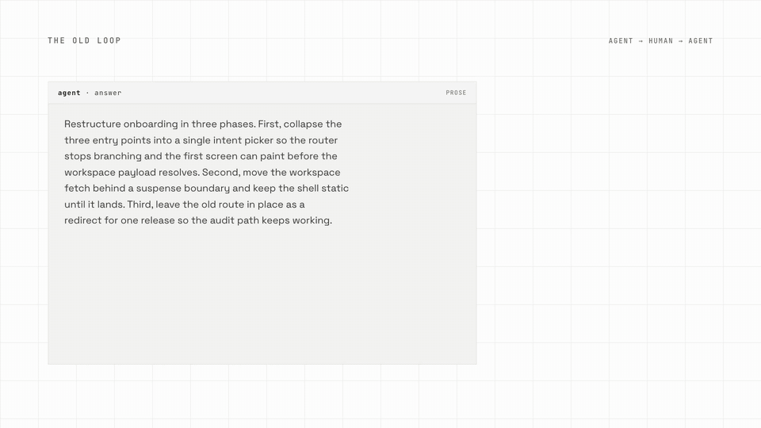

<p align="center"></p>

<h1 align="center">ACRYL AXI</h1>
<h3 align="center">Agent External Interface</h3>

<p align="center"><strong>HTML is the new markdown. ACRYL AXI is the new editor for your HTML artifacts.</strong></p>

<p align="center">Extended from <a href="https://github.com/kunchenguid/lavish-axi">Lavish Editor</a> by Kun Chen — MIT.</p>

<p align="center">
  <a href="https://acryl.dev/acrylaxi">Website</a> ·
  <a href="https://github.com/acryldev/acrylaxi">GitHub</a> ·
  <a href="https://discord.gg/cY9KXMex69">Discord</a> ·
  <a href="https://www.npmjs.com/package/acrylaxi">npm</a>
</p>

<p align="center">
  
</p>

## What it is

An agent asked to "show me the plan" answers with prose, a pasted table, or a screenshot. Prose is hard to point at. A screenshot cannot be sent back as an edit. HTML is the format that can carry the answer, but nothing closes the loop between the page and the agent that wrote it.

ACRYL AXI closes that loop. Your agent writes one HTML file. `acrylaxi` opens it in your local browser as an interactive review surface. You point at elements, select text, draw on whiteboards, queue layout fixes, or type a message, and every piece of that feedback comes back to the agent as a normal prompt with selectors, anchors, and your own words attached.

That loop is the product:

- **Low token cost.** Feedback arrives as text prompts with selectors and anchors, not as screenshots. A note on one table cell costs one short prompt, not an image round trip.
- **Interactive, not a PDF renderer.** The artifact runs in a sandboxed iframe with its own scripts, controls, and diagrams intact. You review the real page, not a picture of it.
- **Local-first.** The server, the state, the artifacts, and the review loop live on your machine. Nothing leaves it except an explicit `share`.
- **Agent-agnostic.** Acrylaxi is an [AXI](https://axi.md), a CLI any capable agent can run with no setup. Claude Code, Codex, OpenCode, GitHub Copilot CLI, DSH/ACRYL agents, and any agent with a shell all work the same way.
- **Part of ACRYL.** Acrylaxi is the artifact surface of the ACRYL ecosystem: the control surface for agents built on the DeepSeek Harness/Cordis runtime. It is useful on its own and better with an ACRYL agent driving it.

Because it is an AXI:

- It is a CLI any capable agent runs directly. No install is required to try it.
- It is optimized for agent ergonomics: TOON output, long polling, and contextual disclosure keep the token cost low.
- The skill and hooks only handle discovery. Agents learn the AXI by using it.

## Quick start

The npm package is `acrylaxi`. Until its first release is published, run it from source (see [From source](#from-source)); every command below is the same afterwards.

### Install the skill (recommended)

Install the `acrylaxi` skill in the [Agent Skills](https://agentskills.io) format with [`npx skills`](https://github.com/vercel-labs/skills):

```sh
npx skills add acryldev/acrylaxi --skill acrylaxi
```

That is the whole setup. No npm install is needed: the skill teaches your agent to run Acrylaxi through `npx -y acrylaxi`, so the CLI comes along on demand. The skill is a short stub that points at `npx -y acrylaxi --help`, `design`, and `playbook` for current instructions, so an installed copy cannot drift from a newer CLI.

Then ask for it directly in agents that expose skills as slash commands (Claude Code, for example):

```
/acrylaxi let's discuss our plan here
```

Or ask for anything easier to grasp visually (a plan, comparison, diagram, table, code view, report) and the agent loads the skill when it recognizes the task. The skill installs into the current project's skills directory by default; add `-g` to install it for all projects.

### Zero setup

Any capable agent can run the CLI with nothing installed:

```
Use `npx -y acrylaxi` to write a product or technical plan for what we discussed.
```

### Session hooks

To feed Acrylaxi's ambient context, including your live open sessions, into every agent session instead of loading it on demand, install the CLI and opt into the hook:

```sh
npm install -g acrylaxi
acrylaxi setup hooks
```

This installs a `SessionStart` hook for **Claude Code**, **Codex**, **OpenCode**, and **GitHub Copilot CLI** that surfaces open sessions, visualization playbooks, and usage guidance at the start of each session. The hook also sees live sessions, so a fresh agent session can resume an in-flight review. Restart the agent session afterwards so the hook takes effect.

### Agent plugin

Acrylaxi also ships as an [Agent Plugin](https://agent-plugins.org), the vendor-neutral packaging format for skills and MCP servers. There is no marketplace involved: the installed package is the plugin, with `plugin.json` at its root next to `skills/`. Install the CLI, then register it:

```sh
acrylaxi setup plugin
```

That registers the installed package with every supported client it finds (**VS Code**, **Cursor**, **GitHub Copilot CLI**) and reports the ones that were absent. It is opt-in and idempotent, and repairs the registered path after a reinstall or relocation. Reload each client afterwards.

Or register by hand with the package directory from `npm root -g`:

| Client             | Register with                                                                          |
| ------------------ | -------------------------------------------------------------------------------------- |
| VS Code            | `"chat.pluginLocations": { "<package-dir>": true }` in user settings                   |
| Cursor             | link the package directory at `~/.cursor/plugins/local/acrylaxi`                       |
| GitHub Copilot CLI | `copilot plugin install <package-dir>` (or `copilot plugin install acryldev/acrylaxi`) |

Codex and ChatGPT install plugins only from marketplace sources, so Codex users should use the session hook instead. Acrylaxi declares no MCP server, because the CLI itself is the agent interface. The skill and the plugin are alternatives, not a stack.

### From source

```sh
git clone https://github.com/acryldev/acrylaxi.git
cd acrylaxi
pnpm install --frozen-lockfile
pnpm run build
pnpm link
```

## The loop

```
┌───────────────┐
│ Agent writes  │
│ artifact.html │
└───────┬───────┘
        ▼
┌────────────────────────┐
│ acrylaxi <file_path>   │
│ opens local browser UI │
└───────┬────────────────┘
        ▼
┌────────────────────────┐
│ Human annotates text   │
│ or elements, sends     │
│ chat, or queues layout │
│ issues from the inbox  │
└───────┬────────────────┘
        ▼
┌────────────────────────┐
│ acrylaxi poll waits    │
│ and returns prompts    │
│ the user queued        │
└────────────────────────┘
```

## Capabilities

### Artifact handling

- **File-path identity.** Sessions are keyed by the canonical HTML file path, so agents never need opaque IDs. Two paths to the same file are one session.
- **Portable artifacts.** The artifact runs in a sandboxed iframe while Acrylaxi injects a small SDK for annotations, snapshots, feedback controls, and render-time layout checks. Author-defined links and popups can open in top-level tabs, while artifact documents stay sandboxed without same-origin access. Acrylaxi injects no design system, so a saved file renders identically whether it is opened through `acrylaxi` or directly in a browser. Run `acrylaxi design` for the agent-facing design guidance, including optional CDN snippets and the whiteboard (Mermaid) opt-in snippet.
- **Self-paint warning.** `acrylaxi <html-file>`, `export`, and `share` run a render-free check for artifacts missing an explicit page background and return a one-line `self_paint_warning`. The check fails open: any stylesheet link, `@import`, Tailwind runtime script, `color-scheme`, or `html`/`body`/`:root` background signal suppresses it, and it never blocks the open.
- **Open-time layout gate.** The browser chrome masks the artifact only while the real in-iframe audit waits for fonts and final geometry. The first completed client-side check reveals the artifact, whatever it found and even if reporting it fails. The user can click **Show anyway**, and a bounded timeout fails open from every gate state. If the review cannot load at all, the mask names the problem and offers **Check and reload**. A review already open in another tab gets a **Take over here** button instead, because Acrylaxi loads an artifact in one tab at a time.
- **Live reload.** Acrylaxi watches the HTML artifact and preserves review context across reloads: iframe scroll position, an open annotation card's unsent text, and answers to `data-acrylaxi-question` controls. Supported review state and the unsent queue survive a full reload of the review page in the same tab when browser storage is available. They are not shared across tabs. To also reload on sibling asset changes, add `data-acrylaxi-live-reload-root` to the root element or `<meta name="acrylaxi-live-reload" content="root">`. Unsent text that cannot be restored is kept in the conversation panel under **Unsent annotation** rather than dropped.
- **Local assets.** Copy local images, CSS, fonts, and scripts next to the HTML artifact and reference them with relative paths from that directory. Root-prefixed paths such as `/assets/logo.png` do not resolve through the artifact route.
- **One background server.** One detached server serves every session and listens on loopback, plus the machine's Tailscale address when Tailscale is running. It stops after the last session ends or after 30 idle minutes (see Configuration). Upgrading the CLI replaces an older server; open pages show an update banner and never reload on their own while you have unsent text.

### Working with the artifact

- **Precise targets.** Text annotations carry the selected text plus range anchors. Clicking an element inside a table also carries the cell's visible row and column names alongside the exact CSS locator, and leaves a name out rather than guessing when merged cells make it ambiguous.
- **Feedback controls.** Native controls (radios, checkboxes, inputs, selects, buttons, labels, disclosure summaries, contenteditable) and custom widgets with an interactive ARIA role are interactive automatically, so they need no `data-acrylaxi-action`. A link stays annotatable when it carries such a role or sits inside such a widget. Artifacts can start in explore mode with `data-acrylaxi-annotate="off"` on the root `<html>` element so stray clicks do not open annotation cards; annotation stays on by default and the toolbar can override it. Mark only custom (non-native) clickable elements with `data-acrylaxi-action`. Use `data-acrylaxi-question` or `queueKey` when pre-send updates for the same question should replace each other, and `window.acrylaxi.queuePrompt()` to queue one final answer. `acrylaxi playbook input` owns the author guidance.
- **Layout issues inbox.** Detection is passive. After fonts and finite animations settle, the injected SDK confirms severe failures from direct rendered evidence such as materially escaped content, clipped text, unreachable controls, or near-total semantic occlusion. Explicit ellipsis, visually hidden text, intentional scrollers, decorative overlap, and uncertain motion do not produce findings. Proven failures are filed behind a **Layout issues** button that is hidden while nothing is unresolved and otherwise shows the count. Each issue lists severity, explanation, viewport, target, last-seen time, and lifecycle state, with **Reveal** and **Dismiss** per issue. **Queue selected fixes** turns the chosen group into one ordinary prompt tagged `layout-warnings`, which reaches the agent through the normal feedback path. Detection never wakes a poll; only a user queueing a fix does.
- **Layout issue lifecycle.** Each issue is identified by a stable fingerprint of rule, target, and viewport class, so repeat detections update one record. `Open`, `Queued for fix`, `Resolved`, `Still present`, `Unverified`, and `Returned` describe what the checks observed across revisions. Dismissal applies only to the current artifact revision, and a viewport removed from the diagnostic set is marked obsolete rather than fixed.
- **Revisions legend.** Opt-in. After a round of feedback the agent regenerates the whole file, and a one-sentence edit is invisible on a long artifact. The agent can declare what changed with one `<script type="application/json" data-acrylaxi-revisions>` array of `{ id, label, timestamp, summary }` entries, plus `data-acrylaxi-revision="<id>"` on each block it edited. A **Revisions** button then appears with a legend listing each round (colour swatch, label, time, summary) and **Reveal** steps through that round's changed blocks. Swatches carry a distinct border style and fill pattern as well as a colour, up to 6 revisions are listed, and a malformed registry is ignored rather than surfaced as an error. The legend lives in the browser chrome, so the served file stays identical, and the registry travels with the file through export. Run `acrylaxi design` for the snippet.
- **Live tab title and icon.** Opt-in. The browser tab adopts the artifact's `<title>` and first `<link rel="icon">` when it loads. A long-lived artifact can keep the tab current with `window.acrylaxi.setDocumentMeta({ title, icon })`: a string sets the field, `null` restores the load-time value, and an omitted field is left alone. The title is trimmed to 120 characters and shown as `<title> · Acrylaxi`; the icon must be a `data:image/svg+xml` URL of at most 8192 characters. A value lasts until the next call or a reload, and the call is a no-op outside Acrylaxi, so feature-detect with `window.acrylaxi?.setDocumentMeta?.(...)`.
- **Mermaid diagrams as whiteboards.** Whiteboards are opt-in: agents author a diagram as Mermaid only when you ask for an editable whiteboard, and hand-authored inline SVG is the default figure medium. Every rendered Mermaid diagram in a `.mermaid` container becomes an embedded editable Excalidraw whiteboard: click to unlock editing, use Fullscreen to work over the whole viewport, and scenes autosave locally. **Queue feedback** adds a bounded edit summary plus local `.excalidraw` scene and PNG preview paths to the Conversation panel. The Mermaid source stays authoritative: the agent updates it, and saved, standalone, and exported artifacts still render plain Mermaid. If a live reload changes the Mermaid source, an unmodified whiteboard re-converts silently; an edited one asks before discarding edits. Flowchart, sequence, class, ER, and state diagrams convert to editable shapes; other diagram types are images reviewers can draw on.
- **Whiteboard libraries.** Copy Excalidraw library files (`.excalidrawlib`, for example from [libraries.excalidraw.com](https://libraries.excalidraw.com)) into `~/.acrylaxi/excalidraw-libraries/`, or `ACRYLAXI_STATE_DIR/excalidraw-libraries/` when set. Every whiteboard's library panel lists their items, and a dropped item reaches the agent by name in the edit summary. `acrylaxi libraries` lists item refs; an agent can show a flowchart node as one of those icons by adding a `%% acrylaxi-icon <node-id> <library-id>/<item name>` comment to the Mermaid source, which Mermaid ignores everywhere else. Acrylaxi only reads that directory and never downloads libraries. Files over 10 MB, more than 25 MB or 5,000 items in total, and unreadable files are skipped with a reason. Each library carries its author's terms, so check them before use.

### Conversation and review

- **Everything you send is a bubble.** A note on an element, a text selection, a table cell, a diagram node, a whiteboard, a layout-issue batch, or a composer message becomes a bubble on your side of the Conversation panel with an anchor line naming what it was attached to, a quoted excerpt, and, when available, the selector on hover. A queued note sits at the end as a dashed **Queued** bubble with edit and remove controls. While its batch is in flight it reads **Sending**, and once accepted it settles in place as a sent bubble in every tab of the session. Agent replies render a small Markdown subset (paragraphs, line breaks, headings as bold lead lines, lists, fenced and inline code, bold, italic, and http(s) links); tables, images, and raw HTML stay as written, and your own messages are never parsed.
- **Delivery receipts.** Every sent note carries three emoji that light up in turn: 👀 **Seen** when a `acrylaxi poll` takes it, 🛠️ **Working** when the artifact file changes after that, and ✅ **Done** when the agent replies. All three come from what the server observes; the agent does nothing extra. Until 👀 lights, the row says why: no agent is listening, or the agent is busy and the note is delivered on its next poll. A note answered without touching the artifact goes Seen to Done with Working still grey. See [docs/delivery-acks.md](docs/delivery-acks.md).
- **Image attachments.** Attach reference images (PNG, JPEG, WebP) by pasting, drag-dropping, or using the image picker; each shows a thumbnail chip with upload, remove, retry, and error states. Images are stored under the state directory and the queued prompt carries a server-generated absolute `path` and content-hash `id`, so `acrylaxi poll` hands the agent a local file path to open. Caps default to 10 MiB per image, 4 attachments per prompt, and 25 MiB per prompt; an over-limit or missing image rejects the whole batch and preserves the queue, with the reason shown in the composer. Unreferenced attachments expire after 7 days and total attachment disk defaults to 512 MiB.
- **Reviewing on a phone.** Below 860px wide, the artifact takes the whole screen above a **Conversation** dock, and the conversation opens as a bottom sheet over it: tap the dock, swipe it up, or press the chevron; lower it by tapping the dimmed artifact, swiping down, pressing the chevron, or pressing Escape. The dock reports queued prompts, an unseen reply, or whether the agent is listening, and the sheet stays open across a reload. Wider screens keep the side-by-side layout.
- **Keyboard shortcuts.** In the composer, Enter sends queued prompts and Shift+Enter inserts a newline. In the annotation card, Enter queues, Shift+Enter inserts a newline, and Ctrl+Enter (Cmd+Enter on macOS) queues and sends all queued prompts immediately. Escape closes an empty card, and does nothing once it has text or an attachment. While editing a queued note, Enter saves, Shift+Enter inserts a newline, and Escape discards the edit. Cmd+I or Ctrl+I toggles annotate and explore mode from the chrome or the artifact. In annotate mode a plain click on a link annotates it, while Ctrl+click (Cmd+click on macOS) follows the link in a new tab.
- **Session end etiquette.** Acrylaxi tracks who ended a session. A human clicking **End session** (or **Send & End**) ends it as the user; `acrylaxi end <html-file>` ends it as the agent. Every open review tab becomes visibly read-only and disables feedback once either side ends, and feedback submitted after the end is refused instead of being accepted without an agent to receive it. A plain `acrylaxi <html-file>` after a user-initiated end refuses to reopen and returns guidance; pass `--reopen` only when the user asks for more review. Agent-initiated ends reopen normally. `acrylaxi poll`'s `ended` response and the final `feedback` batch both carry `next_step` guidance telling the agent to stop polling and deliver remaining updates in chat.
- **Agent presence.** The browser shows when no agent is listening and keeps feedback actions available while the agent works. Feedback accepted by **Send** stays queued on the server for the next successful `acrylaxi poll`, across reloads; never-sent notes stay in their tab. An agent reply concludes delivered work and returns presence to waiting. Closing the last review tab while a poll is active starts a 10-second reconnect grace period; if every review stays disconnected the poll returns `browser_disconnected` without ending the resumable session, and the agent asks before reopening or ending it. Set `ACRYLAXI_DISCONNECT_GRACE_MS` to a longer budget, or `0`/`off`, for phones that background the tab.

### Export and sharing

- `acrylaxi export` writes `<name>.export.html` by inlining local assets only, stripping the annotation SDK, and leaving remote CDN/font references as links. It makes no outbound requests, and absolute `file://` paths outside safe inlined references are redacted. Per-asset and per-bundle caps default to 10 MB and 25 MB (`ACRYLAXI_EXPORT_MAX_ASSET_BYTES`, `ACRYLAXI_EXPORT_MAX_BUNDLE_BYTES`).
- `acrylaxi share` publishes the same local-inlined HTML to [ht-ml.app](https://ht-ml.app), a third-party host that is not part of Acrylaxi. Pages are public by default, or private behind a generated password (`--private`) or one you supply (`--password`). A generated password is a shared secret: it is shown once, and an agent relaying it will have it in its transcript. The response carries a secret `update_key` for republishing in place with `--site`/`--update-key`. ht-ml.app has no delete endpoint, so `--unpublish` replaces the page with a locked placeholder instead of removing it, and a page's password cannot be removed. A page switching from public to private can keep serving from the CDN cache for minutes. See [Self-hosting the share backend](docs/self-hosting-share.md) for the API contract if you point `share` at your own backend with `ACRYLAXI_HTML_APP_API_URL`.

## CLI reference

| Command                       | Description                                                                                                                                                                                                                                                                                                                      |
| ----------------------------- | -------------------------------------------------------------------------------------------------------------------------------------------------------------------------------------------------------------------------------------------------------------------------------------------------------------------------------- |
| `acrylaxi`                    | Show current sessions and usage guidance.                                                                                                                                                                                                                                                                                        |
| `acrylaxi update`             | Check for or apply the latest npm release through the AXI SDK self-updater.                                                                                                                                                                                                                                                      |
| `acrylaxi <html-file>`        | Open or resume a review session, with the open-time layout gate enabled by default. Unresolved layout issues from earlier in the session are preserved. Refuses to reopen a session the user explicitly ended from the browser unless `--reopen` is passed.                                                                      |
| `acrylaxi poll <html-file>`   | Long-poll until the user sends feedback, ends the session, or every review stays disconnected past the reconnect grace period. Layout issues arrive only when the user queues them. On `browser_disconnected`, ask before reopening or ending the still-resumable session. On `ended`, stop polling and do not reopen uninvited. |
| `acrylaxi reply <html-file>`  | Post an agent reply and exit 0 only after the server accepts it, so the review page stops showing Working. Exits non-zero if the server does not confirm within 10 seconds. Use it when handing a result back without starting a long poll; `poll --agent-reply` still posts a reply and then waits.                             |
| `acrylaxi end <html-file>`    | End a session as the agent. Unlike a user-initiated end from the browser, this still allows a plain reopen later.                                                                                                                                                                                                                |
| `acrylaxi export <html-file>` | Write a portable copy: one HTML file with its local assets inlined, so it opens with no server and no sibling files. Remote CDN/font references stay links.                                                                                                                                                                      |
| `acrylaxi share <html-file>`  | Publish the artifact (local assets inlined) to [ht-ml.app](https://ht-ml.app) and print a visitable URL plus a secret update key. Republish or unpublish an existing page with `--site`/`--update-key`.                                                                                                                          |
| `acrylaxi stop`               | Shut down the background server.                                                                                                                                                                                                                                                                                                 |
| `acrylaxi playbook [id]`      | List focused artifact guidance or show one playbook. Agents must open each matching playbook before writing HTML.                                                                                                                                                                                                                |
| `acrylaxi libraries`          | List the Excalidraw libraries in the whiteboard library directory; `--search <text>` or `--library <id>` lists item refs for `%% acrylaxi-icon` nodes.                                                                                                                                                                           |
| `acrylaxi design`             | Show agent-facing design guidance, including optional CDN snippets and the whiteboard (Mermaid) opt-in snippet.                                                                                                                                                                                                                  |
| `acrylaxi setup hooks`        | Install or repair optional `SessionStart` hooks for Claude Code, Codex, OpenCode, and GitHub Copilot CLI. Restart the agent session afterwards.                                                                                                                                                                                  |
| `acrylaxi setup plugin`       | Register the installed package as an [Agent Plugin](https://agent-plugins.org) in VS Code, Cursor, and GitHub Copilot CLI. Opt-in, idempotent, no marketplace. Reload each client afterwards.                                                                                                                                    |
| `acrylaxi server`             | Run the local server in the foreground.                                                                                                                                                                                                                                                                                          |

Known playbook IDs: `diagram`, `table`, `comparison`, `plan`, `code`, `input`, `explanation`, `slides`. One artifact often combines several playbooks, so agents match each `use_when` trigger and open every matching playbook before writing HTML. For flows, architecture, state, or sequence diagrams, open the diagram playbook for its SVG guidance.

### Flags

| Command                | Flag                        | Description                                                                                                                                                                                                                                |
| ---------------------- | --------------------------- | ------------------------------------------------------------------------------------------------------------------------------------------------------------------------------------------------------------------------------------------ |
| `acrylaxi <html-file>` | `--no-open`                 | Ensure the server/session exists without opening another browser window.                                                                                                                                                                   |
| `acrylaxi <html-file>` | `--no-gate`                 | Skip the open-time layout curtain for this browser open.                                                                                                                                                                                   |
| `acrylaxi <html-file>` | `--reopen`                  | Reopen a session the user explicitly ended from the browser; without it, a plain open refuses and explains why.                                                                                                                            |
| `acrylaxi update`      | `--check`                   | Report current vs latest npm version without installing an update.                                                                                                                                                                         |
| `acrylaxi export`      | `--out <path>`              | Write the export to a specific path instead of `<name>.export.html` next to the source.                                                                                                                                                    |
| `acrylaxi share`       | `--private`                 | Make the page private behind a generated password returned once; hand it to viewers as a shared secret.                                                                                                                                    |
| `acrylaxi share`       | `--password <pw>`           | Make the third-party ht-ml.app page private with a password you supply. An empty or whitespace-only value is refused rather than publishing a public page.                                                                                 |
| `acrylaxi share`       | `--site <site_id>`          | Republish an existing page in place (with `--update-key`) instead of creating a new one; the URL does not change.                                                                                                                          |
| `acrylaxi share`       | `--update-key <key>`        | The secret returned when the page was published; required to republish or unpublish it.                                                                                                                                                    |
| `acrylaxi share`       | `--unpublish`               | Replace a published page with a locked placeholder (ht-ml.app cannot delete); takes `--site` and `--update-key` and no file.                                                                                                               |
| `acrylaxi share`       | `--token <t>`               | Attach an optional bearer token (`ACRYLAXI_HTML_APP_TOKEN`) when creating a page. Rejected on a republish or `--unpublish`, where the `update_key` is the credential.                                                                      |
| `acrylaxi poll`        | `--owner <label>`           | Identify the process listening for this session; the non-empty label appears in the home session listing. `none` is reserved for sessions without a listener. A second concurrent poll is refused instead of silently returning `waiting`. |
| `acrylaxi poll`        | `--takeover`                | Explicitly displace the current poll listener. The displaced poll exits with typed `LISTENER_REPLACED`; without this flag a new poll fails with typed `LISTENER_ACTIVE`.                                                                   |
| `acrylaxi poll`        | `--agent-reply "..."`       | Show a concise agent reply in the existing browser chat, conclude delivered work, and return presence to waiting before polling again.                                                                                                     |
| `acrylaxi poll`        | `--agent-reply-file <path>` | Read Markdown from a file (`-` for stdin) when a longer reply is genuinely necessary, so newlines survive quoting. Cannot be combined with `--agent-reply`.                                                                                |
| `acrylaxi poll`        | `--timeout-ms <ms>`         | Test/debug escape hatch only; agents should omit it and leave the long poll running.                                                                                                                                                       |
| `acrylaxi reply`       | `--agent-reply "..."`       | Concise reply text. Required unless `--agent-reply-file` is set. The command exits 0 only after the server accepts it; empty text is refused.                                                                                              |
| `acrylaxi reply`       | `--agent-reply-file <path>` | Read the reply from a file (`-` for stdin). Cannot be combined with `--agent-reply`. Same Markdown guidance as `poll --agent-reply-file`.                                                                                                  |
| `acrylaxi stop`        | `--port <port>`             | Shut down a server running on a non-default port.                                                                                                                                                                                          |
| `acrylaxi server`      | `--verbose`                 | Log session and watcher events to stderr; also enabled by `ACRYLAXI_DEBUG=1`. Detached server output is appended with UTC timestamps to `~/.acrylaxi/server.log` (or `ACRYLAXI_STATE_DIR/server.log`).                                     |
| `acrylaxi server`      | `--also-listen <host>`      | Also listen on this concrete address (repeatable). The CLI passes it when it replaces a running server, so the replacement keeps every address the old one served.                                                                         |

## Configuration

State lives under `~/.acrylaxi/` by default, or `ACRYLAXI_STATE_DIR` when set. It is shared across projects and keyed by the canonical artifact path.

| Env var                                                        | Purpose                                                                                                                                                                     |
| -------------------------------------------------------------- | --------------------------------------------------------------------------------------------------------------------------------------------------------------------------- |
| `ACRYLAXI_STATE_DIR`                                           | State directory. Defaults to `~/.acrylaxi/`. Holds `state.json`, `server.log`, attachments, whiteboard sidecars, and `excalidraw-libraries/`.                               |
| `ACRYLAXI_PORT`                                                | Server port. Defaults to `4387`.                                                                                                                                            |
| `ACRYLAXI_HOST`                                                | Explicit bind address, overriding automatic Tailscale detection. Wildcards are restricted to loopback; a concrete value also keeps loopback bound so local CLIs find it.    |
| `ACRYLAXI_LINK_HOST`                                           | Host used in generated session links when automatic Tailscale binding is disabled.                                                                                          |
| `ACRYLAXI_PUBLIC_URL`                                          | Replaces the entire link origin for reverse-proxied links, for example `https://acrylaxi.example.test`. Its hostname is automatically allowed. Invalid values fail startup. |
| `ACRYLAXI_ALLOWED_HOSTS`                                       | Extra `Host` header values to accept (whitespace-separated). `*` disables the check; do that only behind your own proxy or authentication.                                  |
| `ACRYLAXI_NO_OPEN`                                             | `1` is the same as `--no-open`: create or resume a session without launching a browser.                                                                                     |
| `ACRYLAXI_DEBUG`                                               | `1` logs server session and watcher events to stderr.                                                                                                                       |
| `ACRYLAXI_TELEMETRY`                                           | `0`, `false`, or `off` opts out of telemetry. Telemetry is off by default; see [Security & privacy](#security--privacy).                                                    |
| `ACRYLAXI_UMAMI_HOST`                                          | Build-time override of the Umami host; a source build sends nothing unless this and the website id are set.                                                                 |
| `ACRYLAXI_UMAMI_WEBSITE_ID`                                    | Build-time Umami website id; the other half of the explicit telemetry opt-in.                                                                                               |
| `ACRYLAXI_DISCOVER_ALL_INTERFACES`                             | `1` makes every CLI probe every local interface when looking for a server. Only needed for a server bound to a non-loopback address. Prefer `ACRYLAXI_HOST`.                |
| `ACRYLAXI_DIAGNOSTIC_VIEWPORTS`                                | Viewport classes the layout-issue inbox tracks: `mobile`, `compact`, `desktop` (comma-separated, default all).                                                              |
| `ACRYLAXI_IDLE_TIMEOUT_MS`                                     | Idle self-shutdown for the detached server. Defaults to 30 minutes; `0` or `off` disables it.                                                                               |
| `ACRYLAXI_DISCONNECT_GRACE_MS`                                 | How long a poll waits after the last review tab disconnects before returning `browser_disconnected`. Defaults to 10 seconds; `0` or `off` waits forever.                    |
| `ACRYLAXI_HERDR_CHIME`                                         | `1` shows a Herdr request notification and plays its chime when an indefinite poll enters the waiting state. Also requires Herdr's `HERDR_ENV=1`.                           |
| `ACRYLAXI_HTML_APP_TOKEN`                                      | Optional bearer token when creating an ht-ml.app page; also `--token`.                                                                                                      |
| `ACRYLAXI_HTML_APP_API_URL`                                    | Overrides the ht-ml.app API base so `share` points at your own backend.                                                                                                     |
| `ACRYLAXI_EXPORT_MAX_ASSET_BYTES`                              | Per-asset inline cap for `export`/`share`. Defaults to 10 MB.                                                                                                               |
| `ACRYLAXI_EXPORT_MAX_BUNDLE_BYTES`                             | Per-bundle inline cap for `export`/`share`. Defaults to 25 MB.                                                                                                              |
| `ACRYLAXI_MAX_ATTACHMENT_BYTES`                                | Per-image cap. Defaults to 10 MiB.                                                                                                                                          |
| `ACRYLAXI_MAX_ATTACHMENTS_PER_PROMPT`                          | Images per prompt. Defaults to 4.                                                                                                                                           |
| `ACRYLAXI_MAX_PROMPT_ATTACHMENT_BYTES`                         | Total attachment bytes per prompt. Defaults to 25 MiB.                                                                                                                      |
| `ACRYLAXI_ATTACHMENT_TTL_MS`                                   | Expiry for unreferenced attachments. Defaults to 7 days; `0` or `off` disables.                                                                                             |
| `ACRYLAXI_MAX_ATTACHMENT_DISK_MB`                              | Total attachment disk cap. Defaults to 512 MiB; `0` or `off` disables.                                                                                                      |
| `ACRYLAXI_BROWSER_E2E`                                         | Test-only switch for the opt-in browser suites.                                                                                                                             |
| `ACRYLAXI_BUILD_UMAMI_HOST`, `ACRYLAXI_BUILD_UMAMI_WEBSITE_ID` | Build-time inlined defines produced by `scripts/build.js`; not set by hand.                                                                                                 |

Network binding: with Tailscale running, the server listens only on loopback and this machine's Tailscale IPv4 address, never on `0.0.0.0`. Session links use the machine's MagicDNS name, which is the phone-ready URL for other devices on the tailnet. Without Tailscale it falls back to loopback and prints no phone URL. Any explicit `ACRYLAXI_HOST` overrides that detection. One server serves every session on a port; `acrylaxi stop` shuts it down.

## Security & privacy

- **Local-first.** Acrylaxi runs a local server and keeps its state under `ACRYLAXI_STATE_DIR`. The artifact is served from disk, sandboxed without same-origin access, and the only bytes injected are one SDK script tag. A saved artifact renders the same with or without Acrylaxi.
- **The session key is not a secret.** It is derived from the canonical artifact path, so no route treats key possession as authorization. Mutating routes are same-origin guarded.
- **Network exposure.** Binding beyond loopback exposes an unauthenticated server that can read and serve local files to devices that can reach it, so the tailnet or LAN must be trusted. A `Host` allowlist plus an `Origin`/`Referer` guard defend against DNS rebinding, with `ACRYLAXI_PUBLIC_URL` and `ACRYLAXI_ALLOWED_HOSTS` for deliberate proxy setups. Invalid configuration fails startup rather than guessing.
- **Telemetry is off by default.** A source build sends nothing, and no third-party endpoint is used unless a build explicitly configures an Umami host and website id. When enabled, events carry only the command name, version, platform, and architecture; never arguments, paths, artifact content, or prompts. Requests time out after one second and failures are ignored, so telemetry never changes what a command does. Set `ACRYLAXI_TELEMETRY=0` to opt out of any configured build.
- **Sharing is a deliberate third-party action.** `share` publishes to ht-ml.app, which is not operated by ACRYL and stores the page on its servers. Export is local-only and never fetches. See [Self-hosting the share backend](docs/self-hosting-share.md).

## Upstream reference & provenance

ACRYL AXI is extended from Lavish Editor / [lavish-axi](https://github.com/kunchenguid/lavish-axi) v0.1.99 by Kun Chen, under the MIT license. The fork keeps that history and is maintained by ACRYL.dev.

Upstream is vendored as a read-only git submodule at `upstream/lavish-axi`, pinned to `https://github.com/kunchenguid/lavish-axi`. It is reference material: never edit files under `upstream/`, never build or test them, and never import from them. Adoption is always a deliberate port.

Two root scripts report on and move the pin:

```sh
pnpm run upstream:status   # fetch and report pinned vs latest upstream, plus a file-change summary; never modifies the submodule
pnpm run upstream:pull     # fast-forward the submodule checkout to upstream main and print what changed
```

`upstream:pull` moves the submodule checkout only. It does not adapt any Acrylaxi file, because a product-level rename (lavish to acrylaxi) cannot be fast-forwarded. Read the reported diff and port what applies by hand. Policy, script details, and the port checklist live in [docs/upstream-reference.md](docs/upstream-reference.md).

Both licenses and attribution requirements are recorded in [LICENSE](LICENSE) and [THIRD-PARTY-NOTICES.md](THIRD-PARTY-NOTICES.md).

## Development

```sh
pnpm run check          # build, lint, format check, typecheck, tests, and generated-file freshness
pnpm run build          # bundle the publishable CLI, chrome, and design assets
pnpm run build:skill    # regenerate the installable acrylaxi skill
pnpm run build:plugin   # regenerate plugin.json
pnpm test               # run node:test tests
pnpm run lint           # run ESLint
pnpm run format:check   # check Prettier formatting
pnpm run typecheck      # run TypeScript checkJs validation
pnpm run upstream:status
pnpm run upstream:pull
```

Architecture internals, security rationale, and easy-to-reintroduce failure modes are owned by [docs/invariants.md](docs/invariants.md). Repository rules for agents are in [AGENTS.md](AGENTS.md).
